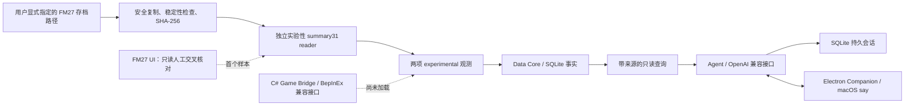

# MVP 架构

本机 macOS Apple Silicon 上已完成一条受限实验性的端到端路径：经 FM27 UI 交叉核对的稳定存档副本 → 独立 Save summary reader → Data Core → Agent → Electron 桌宠 → 中文系统 TTS。摘要 profile 只接受 schema 31 / save build `27.0.0+2486695`，只输出原始球队标签与日历日期。Runtime Bridge 仅离线编译和自测，未加载进游戏。

## 数据流

导入器先确认源文件一段时间保持稳定，再复制到受限本地快照目录并核对源/副本 SHA-256。解析只在副本上进行。首个经验证 profile 使用 `fmsave 0.7.0` 的 MIT 许可容器读取 API，调用本项目的独立严格语法 reader；不调用该项目拒绝 FM27 的 FM26 `Save` reader。任何 profile 不匹配都不输出观测。

首个样本经 UI 交叉核对，形成 `club_label=曼联` 与 `game_date=2026-07-13` 两项 `experimental` 事实。精确首样本 SHA 标记为已交叉核对。之后匹配 build/schema 的新副本只获得语法/profile 检查状态，不承袭首样本的 UI 证据。此能力不含俱乐部 UID、球员/阵容/属性、球赛事件或实时运行时数据。

Save 是某次写盘的 snapshot；要刷新时必须显式重新导入，不是 watch service，也不等同实时内存。Data Core 按来源与状态保存事实；Agent 只能用受控只读查询。一次真实模型回复在 Companion 显示，并由桌面端中文 `say` 朗读，语音进程退出码为 0。聊天写入 SQLite，重启后可恢复。两次真实模型请求已达到应用侧持久预算上限；后续请求被拒绝，启动或导入本身不触发模型调用。

## Runtime 桥

C# 插件依赖指定目录的 BepInEx compatibility DLL 外部引用，Runtime 代码可离线编译和 self-test；第三方 DLL 不包含在项目插件输出中。主线程门、有限 UI 文字读取和只读网络发送均完成离线验证。仍未完成实际 FM27 运行时加载、字段语义验证或 Windows 游戏插件验证。shadow 签名/启动流程处于默认 dry-run，具体隔离方案待审核和用户批准，私有 shadow 目录尚未创建。

Game Bridge 与 Save Adapter 保持独立。任何模式都不通过更改游戏状态或存档来取得数据。UI/存档字段不足时保持缺失状态，不靠 Agent 推测补齐。

## 平台状态

| 层 | macOS Apple Silicon | Windows x64 |
| --- | --- | --- |
| Python 服务 / Electron Companion | 实机端到端已通过（限两字段实验性快照；模型调用受已用完的本地限额约束） | ZIP 已构建、CI 准备检查已过；Windows 实际运行尚未验证 |
| Save Adapter | 首样本 profile 实机验证，两字段、snapshot only | profile 可移植性不等于 Windows 本机验证 |
| Runtime Adapter | 离线编译/self-test 通过；游戏加载待审阅和批准 | 离线自测可运行；Windows 游戏加载未验证 |

FM27 安装版本 `27.0.0.2486716` / Steam build `26227640`，但交叉核验首个 summary profile 标为 `27.0.0+2486695`。不得把其中一个构建标识替换为另一个，也不要推断 sample 包含整份球队数据。Windows 打包成功不等于在 Windows 系统上实测。
